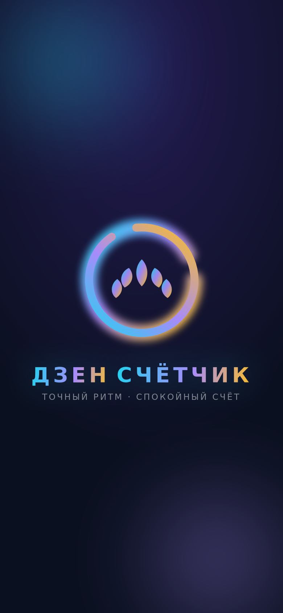
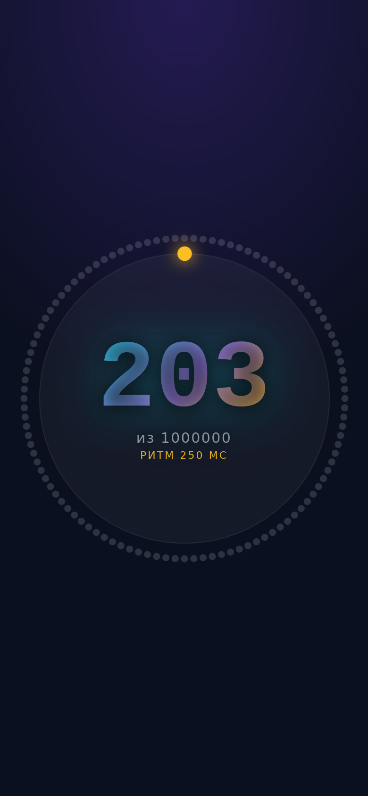
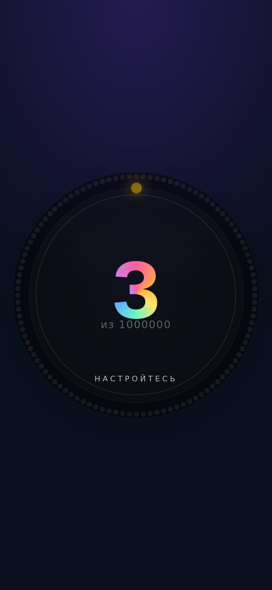
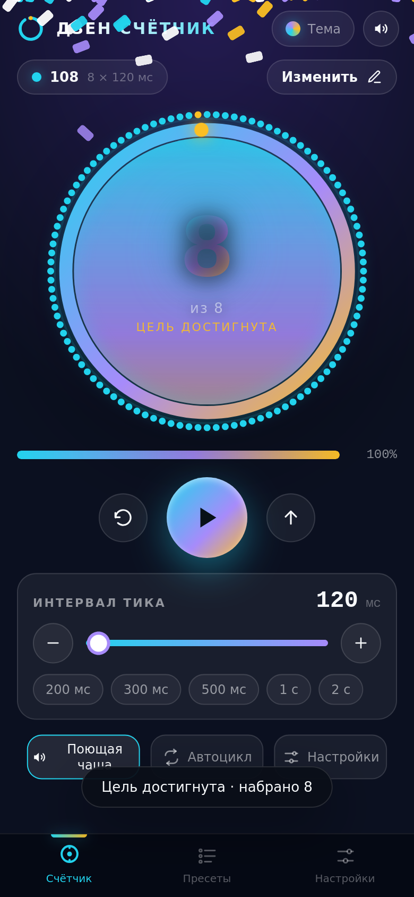
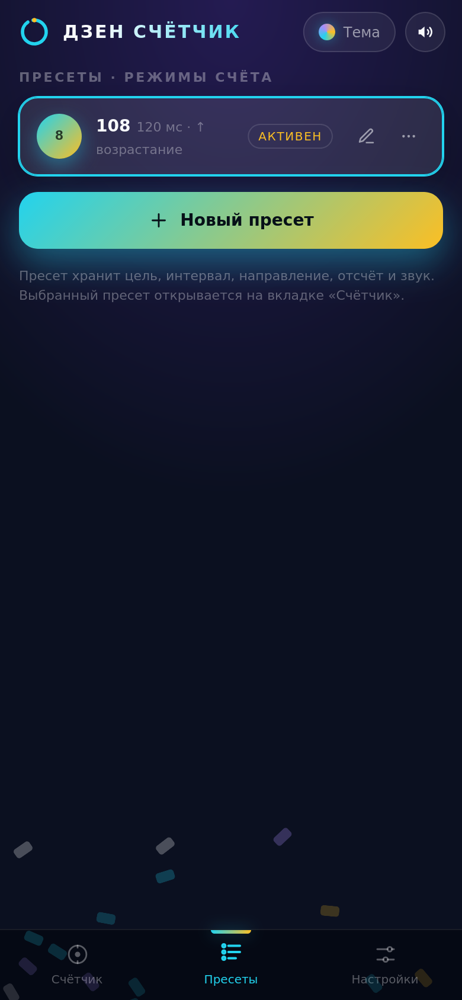
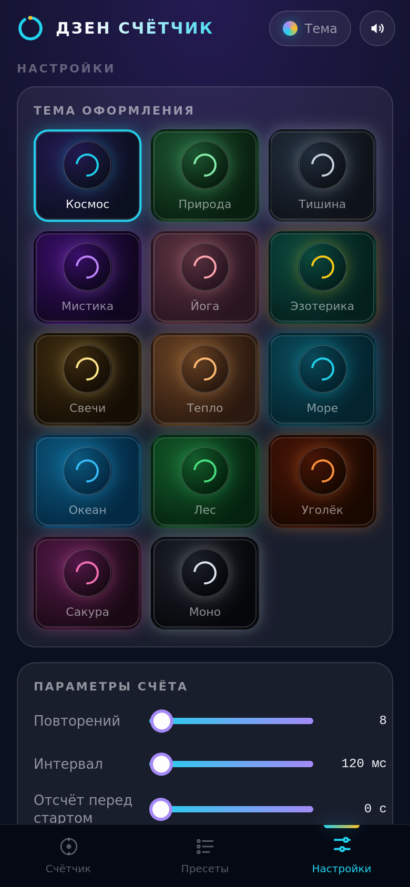
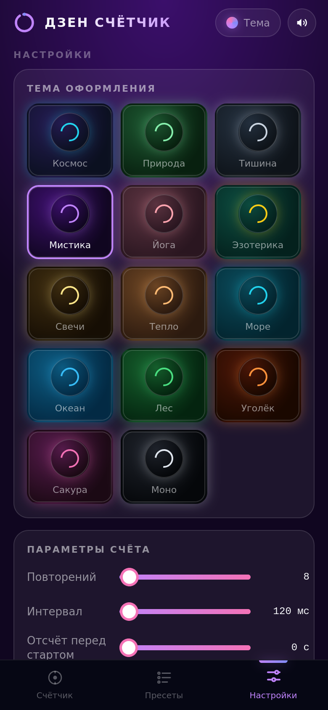
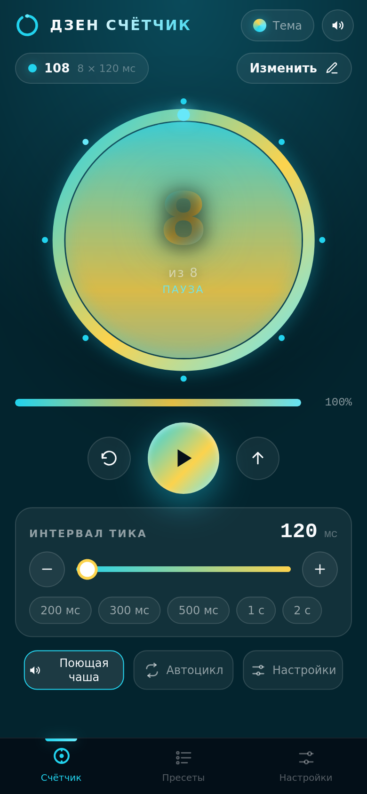
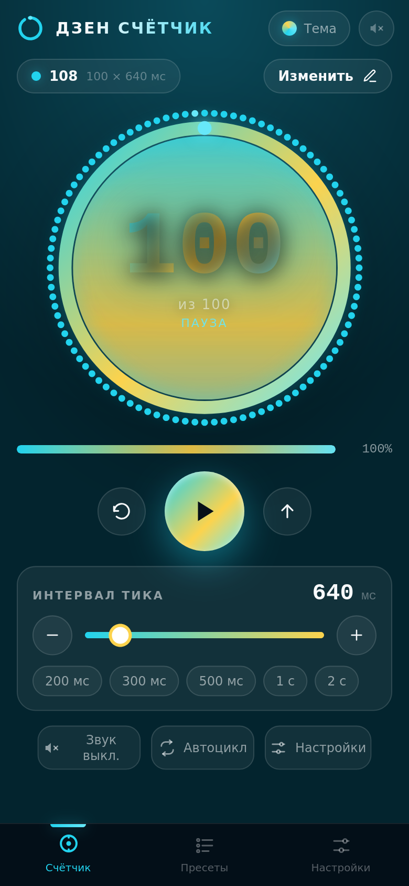
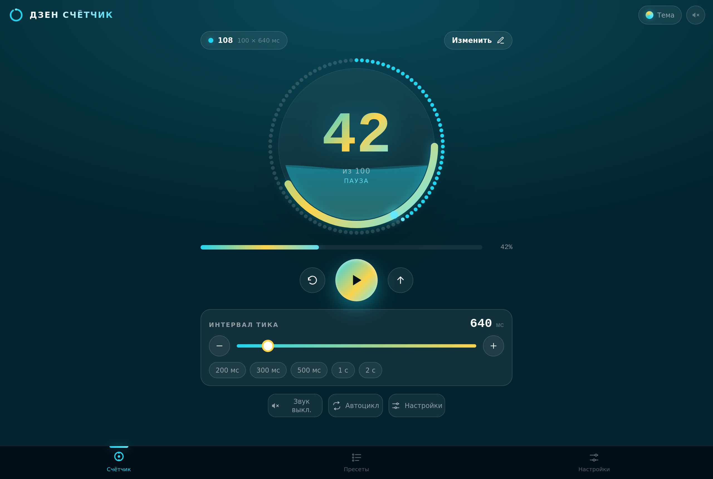

# Отчёт о тестировании «Дзен счётчик»

Дата: 2026-11-11
Итог: 24/24 проверок пройдено

| Проверка | Результат | Детали |
| --- | --- | --- |
| Загрузка приложения | ✅ PASS | title="Дзен счётчик" |
| Нет ошибок в консоли | ✅ PASS | чисто |
| Анимированная заставка показывается | ✅ PASS | splash в DOM |
| Точность тиков, интервал 300 мс | ✅ PASS | n=39, ожидание 300 мс / медиана 300.0 мс (дрейф 0.0) / среднее 300.1 мс (дрейф 0.05) / накоплено 2 мс / σ=13.8 / min 266 / max 331 |
| Точность тиков, интервал 700 мс | ✅ PASS | n=24, ожидание 700 мс / медиана 700.0 мс (дрейф 0.0) / среднее 699.4 мс (дрейф -0.63) / накоплено -15 мс / σ=9.7 / min 673 / max 727 |
| Точность тиков, интервал 100 мс (минимум) | ✅ PASS | n=201, ожидание 100 мс / медиана 100.0 мс (дрейф 0.0) / среднее 100.0 мс (дрейф -0.00) / накоплено -1 мс / σ=6.8 / min 71 / max 129 |
| Дрейф не накапливается (200 тиков × 100 мс) | ✅ PASS | движок -1 мс за 201 тиков / setInterval-эталон 479 мс (та же вкладка) |
| Оригинал: точность тиков, 500 мс (для сравнения) | ✅ PASS | n=24, ожидание 500 мс / медиана 501.5 мс (дрейф 1.5) / среднее 506.8 мс (дрейф 6.83) / накоплено 164 мс / σ=35.3 / min 444 / max 664 |
| Счётчик запускается и считает | ✅ PASS | count=203 |
| Полноэкранный режим включается по тапу | ✅ PASS | fullscreenElement=true |
| Обратный отсчёт отображается | ✅ PASS | 3 настройтесь |
| После отсчёта счётчик стартует сам | ✅ PASS |  |
| Режим фокуса: спрятана обвязка, осталась сфера | ✅ PASS | is-focus=true / header none, nav none, strip none, transport none, actions none, dial flex |
| Достижение цели останавливает счёт | ✅ PASS | count=8/8 |
| Режим фокуса снимается после остановки | ✅ PASS | is-focus=false, header=flex |
| Экран пресетов | ✅ PASS | 1 пресетов |
| Экран настроек и тем | ✅ PASS | 14 тем |
| Смена темы применяется | ✅ PASS | --accent=#c084fc |
| При новом запуске счёт 0, остальное сохраняется | ✅ PASS | {"count":0,"interval":640,"muted":true,"theme":"sea"} |
| Жидкость в сфере поднимается с прогрессом | ✅ PASS | 0 → 340px, 50 → 170px, 100 → 0px |
| Жидкость заметная (градиент яркий) | ✅ PASS | stop-opacity: 0.93 / 0.78 / 0.62 |
| Кромка волны отрисована | ✅ PASS | слоёв с подсветкой: 2 |
| Адаптивная вёрстка (desktop) | ✅ PASS |  |
| Нет ошибок в консоли после всех действий | ✅ PASS | чисто |

## Точность интервалов

Медиана — основной показатель (устойчива к шуму таймеров ОС); среднее и σ приведены для полноты.

| Движок | Интервал | Медиана (дрейф) | Среднее (дрейф) | Накоплено за серию | σ |
| --- | --- | --- | --- | --- | --- |
| Новый (абсолютное планирование) | 100 мс | 100.0 (0.0) | 100.00 (-0.00) | -1.0 мс | 6.77 |
| Новый | 300 мс | 300.0 (0.0) | 300.05 (0.05) | 2.0 мс | 13.81 |
| Новый | 700 мс | 700.0 (0.0) | 699.38 (-0.63) | -15.0 мс | 9.72 |
| setInterval-эталон (та же вкладка) | 100 мс | 101.0 (1.0) | 102.44 (2.44) | 479.0 мс | 4.73 |
| Оригинал (setInterval) | 500 мс | 501.5 (1.5) | 506.83 (6.83) | 164.0 мс | 35.26 |

## Скриншоты

- 
- 
- 
- 
- 
- 
- 
- 
- 
- 
